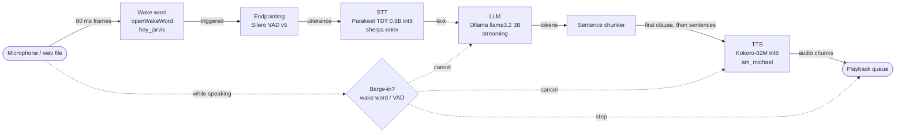

# Jarvis: a local-first voice assistant

Say "Hey Jarvis", ask something, hear an answer. Everything runs on the machine:
wake word, voice activity detection, speech recognition, the language model and
speech synthesis. No audio or text leaves the computer.

The point of the project is the engineering around the models: a streaming
pipeline that starts talking after the first clause instead of the whole reply,
barge-in that cancels in-flight LLM and TTS work, a timestamp on every stage of
every turn, and benchmarks whose numbers all come from runs on a 13-inch MacBook
Pro (M2, 8 GB RAM) (`docs/RESULTS.md`, regenerated from `docs/results/*.json`).

## Results (13-inch MacBook Pro, M2, 8 GB; full tables and commands in `docs/RESULTS.md`)

**End of speech -> first audio out**, 30 spoken requests per mode, replayed in real
time through the whole pipeline (wake word, Silero endpointing, Parakeet, Ollama
`llama3.2`, Kokoro):

| Mode | p50 | p95 |
|---|---|---|
| Streaming, first chunk at a clause (default) | **1,953 ms** | **2,773 ms** |
| Streaming, whole sentences | 2,712 ms | 3,765 ms |
| No streaming (whole reply, then TTS) | 3,475 ms | 5,119 ms |

Default-mode breakdown (p50): endpointing silence wait 640 ms, STT 296 ms, LLM
first token 169 ms, first speakable chunk 270 ms, first chunk synthesised 560 ms.
Streaming saves ~1.5 s at the median; most of the rest is the fixed 600 ms
end-of-speech wait and Kokoro on CPU.

| Other measurements | Result |
|---|---|
| STT WER, LibriSpeech test-clean (200 utts, 40 speakers) | Parakeet TDT 0.6B int8 **2.38%** (RTF 0.034); faster-whisper small int8 3.47% (RTF 0.208) |
| Wake word false rejects, t = 0.5, 168 synthetic clips per condition | 1.2% clean, 3.0% white noise 10 dB, 9.5% babble 10 dB, 52% babble 0 dB |
| Wake word false accepts, 5.4 h of LibriSpeech | 1 (0.18 / hour) at t = 0.5 |
| Barge-in, 10 trials | wake detected ~38 ms after "Hey Jarvis" ends; playback stopped 8 ms later |
| Peak RAM during the latency run | jarvis 1.23 GB RSS + Ollama 2.44 GB = 3.63 GB |
| Kokoro speed (RTF) | int8 0.133, fp16 0.210, fp32 0.248 |

Everything runs together on the 8 GB machine. Machine-wide swap (already in use by
other apps before the run) grew by ~0.4 GB during the latency run; the minimum
"available" memory seen was 746 MB.

## Pipeline



Each stage is a small interface (`WakeWord`, `Vad`, `Stt`, `Llm`, `Tts`,
`AudioSource`, `AudioSink`), so engines swap without touching the pipeline, and
the tests run the whole loop with fakes. `jarvis run --input` replays a wav file
through exactly the same loop as the live microphone, in real time, which is
what the latency benchmark and the smoke test use.

## Install

Requires macOS or Linux, [uv](https://docs.astral.sh/uv/) and
[Ollama](https://ollama.com). Tested on macOS 15 / Apple M2 / 8 GB.

```bash
git clone https://github.com/cwilson-111/jarvis && cd jarvis
uv sync                    # Python 3.12 venv with all engines (add --extra whisper for the STT comparator)
ollama pull llama3.2       # 2 GB
uv run jarvis download     # ~585 MB of models into ./models (pinned URLs, SHA-256 checked)
uv run jarvis doctor       # models present? microphone readable? Ollama reachable?
```

`jarvis download` fetches Silero VAD, the three openWakeWord ONNX files, Kokoro
v1.0 int8 plus its voices, and Parakeet TDT 0.6B v3 int8 (sherpa-onnx export).
On Apple Silicon, use uv's native Python (the project pins this in
`pyproject.toml`); an x86_64 Python under Rosetta has no onnxruntime wheel.

## Usage

```bash
# Live: wake word, then speak. Ctrl-C to quit. Headphones recommended (see Barge-in).
uv run jarvis listen
uv run jarvis listen --ptt                 # push-to-talk: press Enter, then speak

# Same pipeline from a file (deterministic, no microphone)
uv run jarvis say "Hey Jarvis, what is the capital of Australia?" --voice af_heart --out q.wav
uv run jarvis run --input q.wav --output reply.wav
uv run jarvis run --input q.wav --speak    # play the reply through the speakers

# Options shared by listen/run
--model llama3 --voice bm_george --stt whisper --no-streaming --barge-in vad

# Benchmarks (write docs/results/*.json and regenerate docs/RESULTS.md)
uv run jarvis bench latency      # 30 turns x 3 modes + 10 barge-in trials + peak RAM
uv run jarvis bench stt          # LibriSpeech test-clean subset (downloaded on demand)
uv run jarvis bench wake         # synthetic positives + 5.4 h of LibriSpeech negatives
uv run jarvis bench tts          # Kokoro int8 vs fp16 vs fp32
```

Every turn appends one JSON line to `traces/<session>.jsonl` with all stage
timestamps, the transcript, the reply, the engines and the model Ollama reported:

```json
{"turn": 1, "marks_ms": {"wake_detected": 0.0, "speech_start": 399.9, "speech_end": 2725.44,
 "endpoint": 3356.22, "stt_done": 3549.21, "llm_first_token": 3952.34, "llm_done": 4484.35,
 "first_sentence_ready": 4484.41, "first_audio_ready": 5410.91, "first_audio_out": 5410.94,
 "done": 12147.48},
 "stages_ms": {"endpointing": 630.78, "stt": 193.0, "llm_ttft": 403.12, "first_sentence": 532.08,
 "tts_first": 926.5, "playback_start": 0.02, "compute": 2054.72, "e2e": 2685.5, "llm_total": 935.14},
 "outcome": "replied", "user_text": "what's a good way to remember people's names?",
 "engines": {"wake": "hey_jarvis_v0.1", "stt": "parakeet-tdt-0.6b-v3-int8", "llm": "ollama:llama3.2",
 "tts": "kokoro-82m-v1.0-int8:am_michael"}, "...": "..."}
```

Configuration lives in an optional `jarvis.toml` (see `jarvis.example.toml`);
unknown keys are rejected so a typo can't silently run a different model.

## Design decisions

**Wake word: openWakeWord `hey_jarvis_v0.1`.** A pre-trained "hey jarvis"
model that needs no account or API key (Porcupine does) and costs a couple of
milliseconds per 80 ms frame on CPU. Its license is non-commercial (see
License), which is fine for a personal assistant. It is fed every frame in every
state so its 1.28 s context window is never stale; decisions are gated by state
and a 1.5 s refractory period. Push-to-talk (`--ptt`) is the fallback.

**VAD / endpointing: Silero VAD v5**, run directly through onnxruntime (a 2 MB
model; no PyTorch). A pure state machine (`vad.Endpointer`) turns per-frame
probabilities into speech start (160 ms of speech) and end of utterance (600 ms
of silence). That 600 ms is the single largest fixed cost in the latency
breakdown and the main knob (`[vad] end_silence_ms`): lower is snappier but cuts
people off mid-pause. Audio from 2 s before the wake trigger is kept, so a
run-on "Hey Jarvis what's..." is transcribed whole; the wake phrase is then
stripped from the transcript. A bare "Hey Jarvis" followed by a pause keeps
listening for the request.

**STT: Parakeet TDT 0.6B v3 (int8) via sherpa-onnx.** Strong accuracy for its
size, punctuation and casing included, and fast on CPU. faster-whisper `small`
(int8, greedy) is wired in as a comparator (`--stt whisper`); see Results.

**LLM: Ollama `llama3.2` (3B, Q4_K_M).** At 2 GB it fits on an 8 GB machine next
to the speech models. The model name lives in config, is printed at startup and
by `doctor`, and the model Ollama actually reports back is written into every
trace, so a run can't silently use a different model than it claims. Replies
stream over `/api/chat` with a short spoken-style system prompt and the last 8
exchanges as memory; on barge-in only what was actually sent to the speaker is
remembered. Malformed or missing stream data raises an error (the assistant then
says it can't reach its model); it never becomes a silent default.

**TTS: Kokoro-82M v1.0, int8 ONNX** (kokoro-onnx), voice `am_michael`. The int8
export is both the smallest and the fastest on this CPU (`jarvis bench tts`).
One measured trap: the espeak-ng phonemizer that Kokoro uses re-initialises in
every new thread, adding ~500 ms. Every reply runs in fresh threads, so this hit
every first sentence until synthesis was pinned to one long-lived worker thread
(`tts.KokoroTts`).

**Streaming.** LLM tokens go through `chunker.SentenceChunker`, which commits to
a boundary only after seeing the character after the punctuation (so `3.14`,
`Dr. Smith` and `e.g.` survive) and merges fragments under 10 characters. With
`first_chunk = "clause"` (default) the *first* chunk may end at a comma, so
speech starts on "The tallest building in the world is the Burj Khalifa,"
instead of after the whole sentence; later chunks are whole sentences for
natural prosody. A producer thread (LLM -> chunker) feeds a coordinator (TTS ->
playback queue), so sentence 2 is synthesised while sentence 1 plays.

**Barge-in and echo.** While speaking, the microphone is still read. With
`barge_in = "wake"` (default), saying "Hey Jarvis" stops playback within one
audio block, closes the HTTP stream so Ollama stops generating, drops queued
sentences, and starts listening; "stop" / "never mind" then end the turn without
an LLM call. There is **no acoustic echo cancellation**: the mic hears the
speaker. The wake model rarely fires on the assistant's own voice, which is why
it is the default. `barge_in = "vad"` (interrupt by just talking) uses a guard
(ignore the first 600 ms of playback, then require 400 ms of confident speech),
which is enough with **headphones** but will self-interrupt on loud laptop
speakers. Use headphones for VAD barge-in; macOS's voice-processing I/O (which
has AEC) is not wired in.

**Untrusted text.** LLM and STT output is treated as untrusted input: it is only
ever passed to the TTS as data, written to JSON traces via `json.dumps`, and
stripped of control characters before it reaches the terminal (an escape
sequence in a reply cannot drive the terminal). `docs/RESULTS.md` is generated
without any model-written text.

## Known limits

- No echo cancellation (see above). Use headphones for `--barge-in vad`.
- The 3B model is fast but makes factual mistakes; `--model llama3` (8B) is
  smarter but was not benchmarked here and is tight on 8 GB.
- Wake-word accuracy is measured on synthetic voices only (see the limits in
  `docs/RESULTS.md`); real accents, distance and room noise will be worse.
- One wake phrase, English only; Kokoro and Parakeet support more languages but
  nothing here is wired for them.
- Latency is measured with simulated playback, which excludes the output
  device's buffer (CoreAudio reports about 10-20 ms).
- TTS of a sentence already in progress cannot be interrupted; its audio is
  discarded on barge-in, so CPU stays busy for up to one sentence.

## Project layout

```
src/jarvis/
  cli.py          jarvis listen | run | say | doctor | download | bench
  pipeline.py     Assistant frame loop, Reply (LLM -> chunker -> TTS -> sink), barge-in
  audio.py        MicSource, FileSource, SpeakerSink, FileSink (simulated playback clock)
  wake.py vad.py stt.py llm.py tts.py   engine interfaces + implementations
  chunker.py      token stream -> speakable chunks
  trace.py        per-turn timestamps, derived stage durations, JSONL writer
  config.py       typed TOML config with strict validation
  models.py       pinned model registry + downloader
  wer.py          word error rate + normaliser
  bench/          latency, stt, wake, tts benchmarks and the RESULTS.md renderer
tests/            pytest; fake engines, no models / mic / network / Ollama
docs/RESULTS.md   generated from docs/results/*.json
```

Checks: `uv run pytest`, `uv run ruff check`, `uv run ruff format --check`,
`uv run mypy` (strict). CI runs them on macOS without downloading any model.

## License

MIT. Model weights are downloaded from their upstream releases under their own
licenses (Parakeet: CC-BY-4.0; Kokoro: Apache-2.0; openWakeWord pre-trained
models: CC BY-NC-SA 4.0, i.e. **non-commercial**; Silero VAD: MIT). LibriSpeech
(benchmarks only) is CC BY 4.0.
